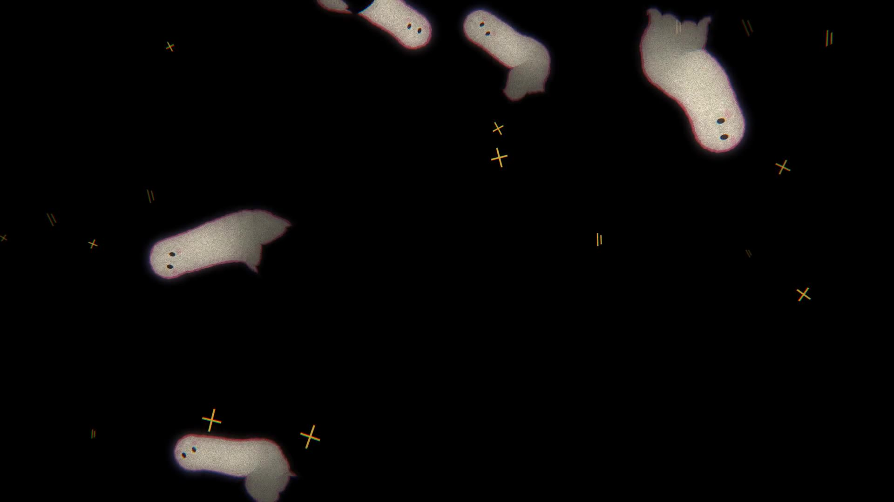

# Ghosts

A Godot 4 app for a projector: pitch-black fullscreen with chalky, softly glowing
ghosts that materialize, drift around and dissolve again. The head leads and the
body follows like slow-motion cloth. Everything is drawn by shaders, so there are
no sprite images to manage.

## Run it on a Mac

1. Install Godot 4.5 (or newer 4.x) from <https://godotengine.org/download/macos/>.
2. Open Godot, choose **Import**, and pick this folder's `project.godot`.
3. Press **Run** (or F5). It opens fullscreen. If a projector is connected, it goes to
   the last screen, which is usually the projector.

### Keys

| Key | Action |
| --- | --- |
| `F` | Toggle fullscreen |
| `S` | Move to the next screen |
| `Up` / `Down` | Add / remove a ghost (they fade in and out) |
| `P` | Spooky screen filter on / off |
| `H` | Show / hide the help line |
| `Esc` / `Q` | Quit |

Command-line options (after `--`): `--screen=1`, `--ghosts=12`.

### Make a standalone app

**Project → Export → Add… → macOS**, then export. Godot asks you to download the
export templates the first time.

## How it works

| File | What it does |
| --- | --- |
| `shaders/ghost.gdshader` | Draws one ghost: chalk body, pink rim, eyes, blush, scalloped hem. The cloth motion lives here. |
| `shaders/spooky_screen.gdshader` | Full-screen filter: bloom, film grain, chromatic fringe, projector flicker, vignette. Darks are clamped to true black so the projector shows nothing between ghosts. |
| `scripts/ghost.gd` | Only the head is driven: it wanders with surges and pauses and turns and glances on its own. The body is a loose chain simulated like cloth (inertia, slight stretch, light bending stiffness, air flutter) that is dragged along behind. Each ghost materializes, lives 15–55 s, then dissolves. |
| `scripts/main.gd` | Keeps up to 5 ghosts around, staggered: they appear one by one at the start, and a new one appears 3–12 s after one dissolves, keeps them apart, handles keys and screens. |
| `scripts/sparkles.gd` | Twinkling gold chalk crosses. |

### Tuning the look

The cloth feel is set at the top of `scripts/ghost.gd`: `stiffness`,
`stretch`, `keep_velocity` (more = more drag, swing and follow-through),
`flutter`, and the big slow underwater undulation `wave_amount` / `wave_speed`.

The look is set by the defaults at the top of `shaders/ghost.gdshader`
(`cloth_amount`, `cloth_speed`, `flare`, `scallops`, `tail_fade`, `glow`, colours)
and the random ranges in `setup()` in `scripts/ghost.gd`.
